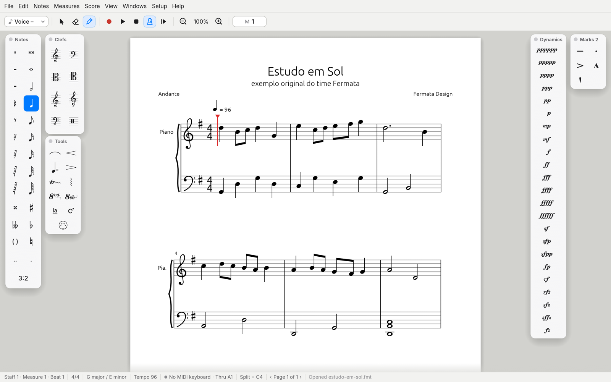

<div align="center">

# 𝄐 Fermata

**Um editor de partituras gratuito para macOS, rápido, direto e feito para quem escreve música no teclado.**

Fermata recupera o fluxo de trabalho dos editores clássicos de partitura (paletas flutuantes, atalhos para tudo, entrada pelo teclado MIDI) num app nativo, moderno e leve, escrito em Rust.


</div>



<sub>Fermata 0.3.1 com o "Estudo em Sol", peça criada pelo time. O app segue o modo claro ou escuro do macOS.</sub>

**[Baixar e instalar →](https://murillowelsi.github.io/fermata/)**

---

## Por que o Fermata

Muita gente aprendeu a escrever partitura em programas que já não existem nem rodam em Macs atuais. O Fermata quer ser a casa dessas pessoas:

- **O fluxo que você já conhece:** a página no centro, paletas flutuantes em volta, um atalho para cada comando e nada de menus escondidos.
- **Toque e veja:** ligue o teclado MIDI, toque, e as notas aparecem na pauta enquanto você toca.
- **Seus arquivos antigos de volta:** abre arquivos `.enc` (compatível com arquivos do Encore), além de MIDI.
- **Gratuito e leve:** um único app universal para Macs Intel e Apple Silicon, sem assinatura nem conta.

## O que ele faz hoje

| Área | Recursos |
|---|---|
| **Entrada de notas** | Mouse com a paleta de figuras; teclado do computador (modo QWERTY); teclado MIDI nota a nota; gravação em tempo real com metrônomo |
| **Notação** | Até 8 vozes por pauta, quiálteras, apojaturas, ligaduras, barras de colcheia, articulações, dinâmicas, crescendos, 8va/8vb, trinados, ritornelos, casas 1 e 2, segno e coda |
| **Texto** | Letras de música (com hífens e melismas), cifras, títulos, textos livres |
| **Edição** | Copiar e colar, transpor, enarmonia, simplificar acidentes, alterar duração e intensidade, adivinhar durações de uma gravação |
| **Playback** | Sintetizador interno ou instrumento MIDI externo (duas portas, A e B), swing, dinâmicas que mudam a intensidade, solo e mudo por pauta |
| **Layout** | Compassos por sistema, sistemas por página, espaçamento, números de compasso, pausas comprimidas, Linear View |

### Arquivos

| Formato | Abrir | Salvar ou exportar |
|---|---|---|
| Fermata (`.fmt`) | ✓ | ✓ |
| Encore (`.enc`) | ✓ | ✓ (exportação experimental) |
| MIDI (`.mid`) | ✓ | ✓ |
| MusicXML | — | ✓ (exportação parcial) |
| Imagem da página (PNG) | — | ✓ |

## Instalação

O passo a passo completo, com imagens de onde clicar, está na [página do Fermata](https://murillowelsi.github.io/fermata/#instalar). Em resumo:

1. Baixe o `Fermata-Installer.dmg` da [versão mais recente](../../releases/latest).
2. Abra o `.dmg` e arraste o **Fermata** para a pasta **Aplicativos**.
3. Dê dois cliques no Fermata. O macOS avisa que não pode verificar o app: clique em **OK** (não em "Mover para o Lixo").
4. Abra **Ajustes do Sistema ▸ Privacidade e Segurança**, role até **Segurança** e clique em **Abrir Mesmo Assim**. Confirme com **Abrir Mesmo Assim** e a senha do Mac.
5. Pronto: daqui em diante ele abre normalmente.

No macOS 14 ou mais antigo, basta clicar com o botão direito no app, escolher **Abrir** e confirmar. O aviso aparece porque o app ainda não tem a notarização paga da Apple.

Requer macOS 10.13 ou mais novo, em Mac Intel ou Apple Silicon.

## Primeiros passos

| Para | Faça |
|---|---|
| Escolher a figura | Clique na paleta **Notes** |
| Escrever uma nota | Clique na pauta com o lápis, ou toque no teclado MIDI |
| Escrever pelo teclado do computador | Pressione **Q** para ligar o modo QWERTY |
| Tocar ou parar | **Espaço** |
| Gravar do teclado MIDI | **Enter** |
| Ir para um compasso | **M** |
| Aproximar ou afastar | **Z** / **Shift+Z** |

### Atalhos principais

A tecla principal é **Ctrl**, igual nos Macs e nos PCs, para quem já tem os atalhos na memória. Os atalhos com **Cmd** equivalentes também funcionam no Mac.

| Atalho | Comando | Atalho | Comando |
|---|---|---|---|
| Ctrl+T | Ligar notas | Ctrl+Alt+M | Adicionar compasso |
| Ctrl+L | Ligadura de expressão | Ctrl+Alt+K | Armadura de clave |
| Ctrl+M | Agrupar colcheias | Ctrl+Alt+T | Fórmula de compasso |
| Ctrl+E | Enarmonia | Ctrl+Alt+Q | Andamento |
| Ctrl+= / Ctrl+− | Subir ou descer meio tom | Ctrl+Alt+S | Adicionar pauta |
| Ctrl+1 … Ctrl+8 | Mudar a voz | Alt+Shift+letra | Abrir uma paleta |

A lista completa fica em **Help ▸ Keyboard Shortcuts**.

### Teclado MIDI

Conecte o teclado (USB ou interface MIDI) e abra **Setup ▸ MIDI Setup**. Ali você escolhe a entrada, a saída (para tocar num piano digital, por exemplo) e testa a conexão. O menu **Help** tem também um guia passo a passo para ligar pianos digitais.

## Compilar a partir do código

Você precisa do [Rust](https://rustup.rs) e das ferramentas de linha de comando do Xcode.

```sh
cargo run --release          # roda o app
cargo test                   # testes
cargo clippy                 # análise do código
./make_mac_app.sh            # gera dist/Fermata.app (universal) e o .dmg
```

### Organização do código

| Arquivo | Papel |
|---|---|
| `src/model.rs` | Modelo da partitura: pautas, compassos, notas, vozes |
| `src/score_view.rs`, `src/glyphs.rs` | Layout e desenho da partitura |
| `src/input.rs`, `src/commands.rs`, `src/exec.rs` | Edição, comandos e atalhos |
| `src/ui.rs`, `src/app.rs` | Interface: menus, paletas, diálogos |
| `src/io.rs`, `src/enc.rs` | Arquivos: formato próprio, MIDI, MusicXML, `.enc` |
| `src/audio.rs`, `src/midi_in.rs`, `src/midi_out.rs`, `src/rec.rs` | Som, MIDI e gravação |

## Próximos passos

- **Fonte musical Bravura na partitura:** as paletas já usam a Bravura; falta a página.
- **Gravação mais precisa:** duas vozes na mesma pauta sem colisões e layout de página melhor.
- **Impressão e PDF** de verdade.
- **Abrir MusicXML**, para trocar arquivos com MuseScore, Sibelius, Finale e Dorico.
- **Tablatura** com números das casas, cordas e afinação.
- **Partes** separadas para cada instrumento, já transpostas.
- **D.C., D.S. e Coda** no playback.

## Status

O Fermata está em **pré-lançamento (0.3.1)**. Ele já serve para escrever e tocar, mas ainda tem arestas: guarde cópias dos arquivos importantes e mande o que encontrar.

## Créditos

Construído com [egui/eframe](https://github.com/emilk/egui), [midir](https://github.com/Boddlnagg/midir), [cpal](https://github.com/RustAudio/cpal), [rfd](https://github.com/PolyMeilleur/rfd) e [serde](https://serde.rs).

Encore é marca de seus respectivos donos. O Fermata é um projeto independente, sem relação com eles, e lê arquivos `.enc` apenas para que você possa continuar usando as suas partituras.
